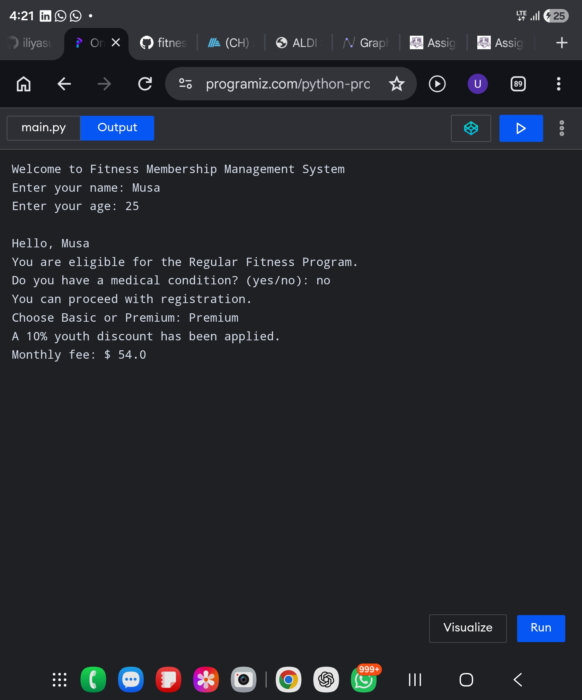

# Fitness Membership Management System

## Project Overview

The Fitness Membership Management System is a beginner Python project designed to manage fitness membership options and eligibility.

It demonstrates how Python programming can be used to make decisions based on user input and membership conditions.

## Features

- Checks fitness program eligibility based on age.
- Checks medical clearance requirements.
- Supports Basic and Premium membership plans.
- Calculates monthly membership fees.
- Applies a youth discount.
- Provides membership recommendations.

## Technologies Used

- Python 3
- Conditional statements ("if", "elif", "else")
- Logical operators ("and", "or", "not")
- Variables and data types
- User input and output
- Nested conditional statements
  
## Project Purpose

This project demonstrates practical beginner-level Python programming skills through a simple fitness membership scenario.

## Author

Abubakar Hassan Iliyasu

## Project Status

In development.

## How to Run the Program

1. Install Python 3.
2. Download or clone this repository.
3. Open the project folder.
4. Run the following command:

python fitness_program.py

## Sample Output

A sample program output is available in "sample_output.txt".

## Skills Demonstrated

- Python programming fundamentals
- Decision-making with conditional statements
- Logical operators
- User input validation
- Basic calculations
- Problem-solving

## Future Improvements

- Add stronger input validation.
- Improve membership plan options.
- Add more membership features.
